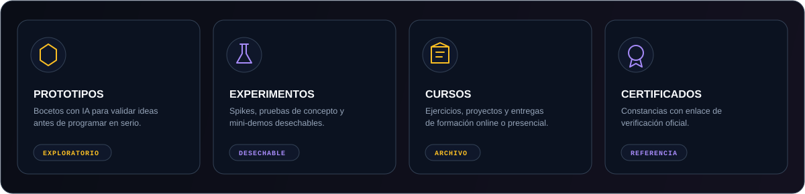
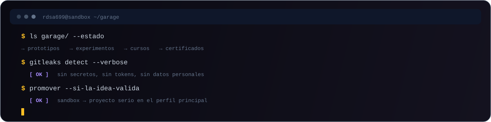

  

  

 

  <a href="#sobre-este-espacio">Sobre este espacio</a>&nbsp;&nbsp;•&nbsp;&nbsp;
  <a href="#del-garage-al-producto">Flujo</a>&nbsp;&nbsp;•&nbsp;&nbsp;
  <a href="#que-hay-en-el-garage">Contenido</a>&nbsp;&nbsp;•&nbsp;&nbsp;
  <a href="#reglas-del-garage">Reglas</a>&nbsp;&nbsp;•&nbsp;&nbsp;
  <a href="#herramientas">Herramientas</a>

 

  
  
  

---

## Sobre este espacio

Soy **RDSA-699**. Este espacio **no es mi portafolio**: es la zona donde aterriza lo que quiero tener versionado y a mano, pero que todavía no merece un repositorio formal.

Si el [perfil principal](https://github.com/RafaelSanguinoAriza) es el escaparate, **esto es el garage**: herramientas a medio usar, prototipos y cajas que abrí por curiosidad.

> **Sobre el uso de IA.** Uso herramientas de IA para bocetar y validar ideas rápido. Lo que avanza a un proyecto real lo reescribo, reviso y pruebo a mano. El criterio técnico es mío; la IA es un lápiz más.

---

## Del garage al producto

  

Este espacio existe para que probar sea barato. Si una idea sobrevive a la validación, **sale de aquí** y se convierte en un repositorio con arquitectura, documentación y seguridad desde el diseño. Si no, habrá cumplido su función: me enseñó algo antes de gastar semanas.

---

## Qué hay en el garage

  

| Carpeta | Contenido | Estado |
| :--- | :--- | :--- |
| [`/prototipos`](./prototipos) | Bocetos de apps generados con IA (OpenCode, Stitch…) | Exploratorio |
| [`/experimentos`](./experimentos) | Spikes técnicos, pruebas de concepto y mini-demos | Desechable |
| [`/cursos`](./cursos) | Ejercicios, proyectos y entregas de formación | Archivo |
| [`/certificados`](./certificados) | Constancias con enlace de verificación oficial | Referencia |

**Lo que no vas a encontrar:** código listo para producción, documentación completa ni garantías de que todo compile en tu máquina. Para mi mejor trabajo, está el [perfil principal](https://github.com/RafaelSanguinoAriza).

---

## Reglas del garage

Que sea informal no significa que sea descuidado. Estas reglas las aplico aquí también:

| Regla | Cómo la cumplo |
| :--- | :--- |
| **Sin secretos** | Nada de claves, tokens ni `.env` en commits. Hay un `.gitignore` base y un escaneo automático con [Gitleaks](https://github.com/gitleaks/gitleaks) en cada push. |
| **Sin datos personales** | Los certificados se listan con enlace de verificación oficial; no se suben PDFs con documento de identidad ni códigos sensibles. |
| **Todo con contexto** | Cada carpeta tiene su `README` con qué es, de cuándo y si funciona. |
| **IA con revisión** | Lo generado se trata como borrador hasta que lo reviso. |

  

---

## Herramientas

  
  
  

  Las uso para prototipar, no para reemplazar el criterio.

---

  Probar rápido, descartar sin culpa, promover lo que vale.  
  <a href="https://github.com/RafaelSanguinoAriza"><b>→ Ver mi trabajo principal</b></a>

